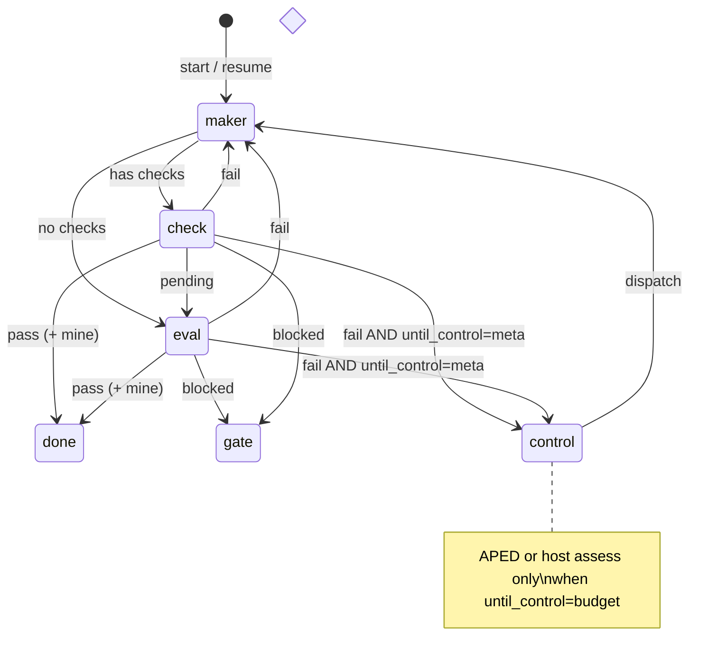

# Design: Meta-style control and budget-aware `until`

**Status:** partial — **M0–M2** shipped (L1 budget + L2 host assess); **M3–M5** proposed  
**Date:** 2026-10-11  
**Sources:** [FINDINGS_META_AGENTIC_META_REASONING.md](FINDINGS_META_AGENTIC_META_REASONING.md) · Meta arXiv [2609.38147](https://arxiv.org/abs/2609.38147) · BATS [2511.17006](https://arxiv.org/abs/2511.17006)  
**Depends on:** [ARCHITECTURE.md](ARCHITECTURE.md) · `loop.py` · `graph.py` · `checks.py` · `traces.py` · `campaign.py` · `company/orchestrator.py`  
**Does not replace:** external check/eval pass-fail ([`loop.py`](../lmloop/loop.py) invariant), authored graphs, or harness evolution evals.

---

## 0. What we take away (outcome levers)

Meta’s results imply **three independent levers** lmloop can pull. They stack; you do not need full APED to get value.

| Lever | Mechanism | Expected outcome | Cost |
|-------|-----------|------------------|------|
| **L1 — Budget visibility** | Maker/orchestrator always see **remaining** tokens, maker cycles, and check/eval rounds | Fewer “silent early stops” and shallow retries when budget remains (Meta: ~18% utilization at 1200 calls under direct control) | **Zero** extra model calls |
| **L2 — Compact run state + artifacts** | Stop growing handoffs linearly; index cycles by ID; pull detail on demand | Better use of long budgets; less context dilution; compositional follow-up (investigate → patch → re-check) | **Zero** or one optional compact call per cycle |
| **L3 — Structured control (APED)** | Host-run Assess → Propose → Evaluate → Dispatch before each maker batch | Higher pass rate on long goals when `until_max_steps` × token budget is large | **+2–8 model calls per maker cycle** (use `eval_model`) |

**When each lever pays off**

| Goal profile | Recommend |
|--------------|-----------|
| Short REPL fix, &lt;3 maker cycles | Default `until_control: off` |
| Medium coding goal with checks | **`budget`** (L1+L2 host-only) |
| Long reconstruction / multi-day campaign | **`meta`** (L1–L3), only if token budget or `until_max_steps` ≥ ~8 |

**Failure modes we explicitly guard against**

| Risk | Mitigation |
|------|------------|
| Controller replaces verification | `Stop` / early exit still requires **check pass** or **eval STATUS: pass** |
| Controller overhead on laptop | `meta` off by default; stages use **`eval_model`**; skip Propose/Evaluate when only one obvious action (host shortcut) |
| Trusting maker self-report | Assess merges **check output**, **git diff**, **snapshot_ref**, not maker prose alone |
| Selection error (right patch, wrong stop) | Eval + checks gate final pass; optional rubric: submitted snapshot must match last passing check window |

---

## 1. Takeaways mapped to lmloop surfaces

### 1.1 `until` (primary)

Today: **maker → check → eval** with `last_handoff()` chaining full maker summaries ([`UntilRun.next_role`](../../lmloop/lmloop/loop.py)). Token cap via `run_token_budget`; cycle cap via `until_max_steps`. That is Meta’s **direct control** pattern.

| Finding | Change | Outcome |
|---------|--------|---------|
| Under-used budget | L1 budget block in `MAKER_PROMPT` + pause reason telemetry | Agent keeps working when cycles/tokens remain |
| Context burial | L2 `run.state` + artifact index; maker gets **instruction + IDs** | Targeted next step instead of re-reading failed attempts |
| Wrong next action after partial pass | L2 host **Assess** from check results (deterministic) | “Fix failing test X” vs rewrite working module |
| Plateau at higher budget | L3 APED before maker when `until_control: meta` | Meta-like scaling when user raises `until_max_steps` / token budget |
| ProgramBench git discipline | Already have **`snapshot.take_snapshot`**; extend Assess to cite `snapshot_ref` + `git diff --name-only` | Verify claims before dispatch |

**State machine (target)**



For `until_control: budget`, **control** is a **host-only** row (no LLM): updated `run.state` + next maker brief — no new states in `next_role` except inserting a **`brief`** builder before maker when resuming after fail.

### 1.2 Authored `graph` (`until` nodes)

| Finding | Change | Outcome |
|---------|--------|---------|
| Long horizons | Graph-level **`run_token_budget`** already flows from host; add shared **artifact dir** per graph run | Join handoffs stop clipping at [`JOIN_HANDOFF_CLIP`](../../lmloop/lmloop/graph.py) for status; IDs reference full artifacts |
| Fixed node sequence | Optional **`control: budget|meta`** on `until` nodes (frontmatter) overriding project config | Per-milestone control without global flag |
| Flow mining | Emit **`artifact_edges`** into run JSONL → [`workflow.py`](../../lmloop/lmloop/workflow.py) reuse metrics | Detect “six independent attempts” vs deep reuse |

### 1.3 `company run` + **campaign**

| Finding | Change | Outcome |
|---------|--------|---------|
| Multi-worker dispatch | Orchestrator **Assess** reads `board.jsonl` + last worker envelopes; **Dispatch** passes artifact IDs in worker packet | Same pattern as Meta workers + context set |
| Daily ticks | Campaign tick runs host Assess on plan + board; Propose is **`ceo` skill** optional | Aligns with [DESIGN_LONG_HORIZON_PLANNING.md](DESIGN_LONG_HORIZON_PLANNING.md) without new store |
| RPM-style pre-filter | Before spawning worker, score 2 candidate briefs (cheap eval model) — **optional M5** | Better GPU/time allocation in research-style company goals |

### 1.4 REPL one-shot `act()`

| Finding | Change | Outcome |
|---------|--------|---------|
| No check loop | Inject **session budget** (rounds left in `max_rounds`) in system steer or user nudge | BATS-style awareness for long threads |
| Not in scope for APED | No controller loop in default REPL | Avoid latency tax on chat |

### 1.5 Evals / self-improvement

| Finding | Change | Outcome |
|---------|--------|---------|
| Coverage vs selection | Golden fixtures record **intermediate good states**; offline metrics on run logs | Separate “found fix” from “landed fix” |
| Abstention | Control **Dispatch** may emit **`abstain`** when budget exhausted and checks blocked | Tie to existing abstention pairs |
| Harness evolution | Trajectory rubrics: **`budget_utilization`**, **`reuse_edges`** | Feed `/retro` and gap reports without changing models |

---

## 2. Control modes (user-facing)

One config key (project or CLI override):

| Value | L1 | L2 | L3 APED | Extra model calls |
|-------|----|----|---------|-------------------|
| **`off`** (default) | — | — | — | 0 |
| **`budget`** | yes | yes (host) | — | 0 |
| **`meta`** | yes | yes | yes | 2–8 per maker cycle |

**CLI (proposed)**

```bash
lmloop until --control budget --check "pytest -q" "goal text"
lmloop until --control meta ...
lmloop graph run company --control budget   # default from config
```

**Config**

```json
"until_control": "off"
```

Allowed: `off` | `budget` | `meta`. No new budget keys — reuse `run_token_budget`, `until_max_steps`, `max_rounds`, `eval_max_rounds`.

**Constants** (not config): `CONTROL_PROPOSAL_MIN = 3`, `ARTIFACT_SUMMARY_MAX = 800`, `RUN_STATE_MAX = 4000` (chars injected into maker prompt).

---

## 3. Run artifacts and compact state (L2)

### 3.1 Layout

Per **until** run (extend existing `~/.lmloop/projects/<slug>/until/<ts>.jsonl`):

```
until/<ts>/
├── run.jsonl              # symlink or move from flat file (migration: optional)
├── state.md               # compact assessment s_t (rewritten each cycle)
└── artifacts.jsonl        # append-only index
```

**Phase 1 (non-breaking):** keep flat `until/<ts>.jsonl`; add sibling dir `until/<ts>.meta/` with `state.md` + `artifacts.jsonl`. Events stay in the flat file until migration.

### 3.2 Artifact record

```json
{
  "id": "a7",
  "ts": "2026-10-11T14:00:00Z",
  "kind": "maker",
  "step": 3,
  "summary": "Added retry to fetch_user; tests still fail on timeout edge case.",
  "refs": ["a5", "a6"],
  "pointers": {
    "session": "~/.lmloop/.../sessions/....jsonl",
    "snapshot_ref": "refs/lmloop/...",
    "check_cmds": ["pytest tests/test_user.py -q"]
  }
}
```

- **`refs`:** context artifact IDs (edges for graph).
- **Host writes** on maker/check/eval append; maker never writes artifacts directly.

### 3.3 `state.md` schema (host + optional LLM)

Sections (markdown headings, fixed order):

1. **Goal** — one line from run meta  
2. **Budget** — tokens used/limit, makers used/limit, invocations left this call  
3. **Status map** — table: subgoal | state (`done|failing|unverified|unknown`) | evidence (artifact id or check cmd)  
4. **Open risks** — bullet list  
5. **Next focus** — single sentence (host or controller)

**Host-only Assess (`budget` mode)** after check/eval fail:

- Parse failing checks from last `check` event `results`.  
- Merge `git diff --name-only` from maker event.  
- Map tests/files → subgoals (heuristic: path components, pytest node ids).  
- Write `state.md`; set **Next focus** to highest-priority failing authoritative check.

### 3.4 Maker prompt change

Replace monolithic `Prior handoff:` with:

```
Run state (compact):
{run_state}

Your assignment this cycle:
{assignment}

Artifact detail (only if needed — prefer tools):
{artifact_excerpts}
```

- **`assignment`:** from host (`budget`) or controller Dispatch (`meta`).  
- **`artifact_excerpts`:** optional clipped bodies for listed IDs; empty in `budget` mode unless assignment cites IDs.

---

## 4. APED controller (`until_control: meta`)

### 4.1 Placement

Run controller **after** `check` fail or `eval` fail, **before** next `maker`. Skip when:

- `until_control != meta`  
- Run is paused or done  
- Host detects **single actionable fix** (one failing authoritative check, no conflicting passes) → shortcut to Dispatch with that instruction (saves Propose/Evaluate)

### 4.2 Stages (one `control` event per stage or one event with substeps)

| Stage | Model | Input | Output (structured JSON in handoff) |
|-------|-------|-------|--------------------------------------|
| **Assess** | `eval_model` | `state.md`, new artifacts since last control, last check/eval | Updated status map + artifact verdicts |
| **Propose** | `eval_model` | Assess output | ≥3 actions: `{id, description, targets[], est_calls}` |
| **Evaluate** | `eval_model` | Proposals + budget remaining | Scored list; drop infeasible |
| **Dispatch** | `eval_model` | Top action | `{instruction, context_artifact_ids[]}` or `{abstain_reason}` |

Store each stage in `run.jsonl`:

```json
{"role": "control", "stage": "dispatch", "status": "next", "handoff": "{...json...}", "usage": {...}}
```

### 4.3 Skills

Packaged private playbooks (not user-facing slash commands):

- `skills/_control_assess.md`  
- `skills/_control_propose.md`  
- `skills/_control_evaluate.md`  
- `skills/_control_dispatch.md`  

Implement via `isolated_act(..., readonly=True, max_rounds=4)` same as eval.

### 4.4 `next_role` extension

After `("check", "fail")` or `("eval", "fail")`:

- If `meta` and last work is not `control/dispatch`: return **`control`** (internal driver runs stage pipeline until dispatch).  
- After successful dispatch: return **`maker`**.

Implement **`control`** as a sub-loop inside `_run_until_body` (not exposed as user role) to avoid combinatorial table explosion.

---

## 5. L1 — Budget visibility (ship first)

### 5.1 Prompt injection

Add to `MAKER_PROMPT` and optionally `EVAL_PROMPT` footer:

```
Budget (this until run):
- Tokens: {run_tokens} / {token_budget or "unlimited"}
- Maker cycles this invocation: {makers_this_call} / {until_max_steps}
- Maker cycles recorded in log: {maker_count}
```

When `token_budget == 0`, show “unlimited” but still show **used** tokens (telemetry).

### 5.2 Steering line

If `until_control != off`, append to maker assignment:

> You may use remaining budget. Prefer verifying failures before large rewrites. Cite check output and files changed.

### 5.3 Traces / usage

On until pause/done, `usage.record("until.budget", utilization_tok=..., utilization_steps=..., control_mode=...)`.

**Acceptance:** golden fixture with high token budget — maker cycle count increases vs baseline when checks keep failing (no behavior change when goal passes in one cycle).

---

## 6. Graph and company hooks

### 6.1 Graph `until` node frontmatter

```markdown
### build
kind: until
goal: ...
control: budget
```

Parser passes `control` into `run_until(..., until_control=...)`.

### 6.2 Company worker packet (M5)

Extend worker stdin JSON:

```json
{
  "assignment": "...",
  "artifact_ids": ["a2", "a4"],
  "artifacts_uri": "file://.../artifacts.jsonl"
}
```

Orchestrator runs host Assess on milestone boundary; **ceo** optional for Propose only.

---

## 7. Metrics (M4)

Compute offline from `artifacts.jsonl` + events (no judge model):

| Metric | Definition | Use |
|--------|------------|-----|
| **Budget utilization (tokens)** | `sum(usage.total_tokens) / run_token_budget` | Detect plateau |
| **Budget utilization (makers)** | maker events / `until_max_steps` | Same for cycle cap |
| **Reuse edges** | count edges where `refs` non-empty | Meta artifact graph analogue |
| **Check pivot rate** | maker cycles after check fail that change files touched in prior passing check | Rewrite vs investigate |
| **Pass depth** | maker index at first check pass | Efficiency |

Optional golden **coverage**: fixture stores hash of tree at intermediate commit; metric = whether run artifacts reference that snapshot.

Wire into [`evals.py`](../../lmloop/lmloop/evals.py) gap lines: `until.low_utilization`, `until.low_reuse`.

---

## 8. Implementation tasks

| ID | Task | Module | Deps | User-visible |
|----|------|--------|------|--------------|
| **M0.1** | Budget block in maker/eval prompts | `loop.py` | — | yes |
| **M0.2** | `usage.record until.budget` on pause/done | `loop.py`, `usage.py` | M0.1 | no |
| **M0.3** | `until_control` config + CLI `--control` | `config.py`, `cli.py`, `parse_until_args` | — | yes |
| **M1.1** | `UntilArtifactStore` append/load | new `run_artifacts.py` or `loop.py` | — | no |
| **M1.2** | Register artifact on maker/check/eval append | `loop.py` | M1.1 | no |
| **M2.1** | Host Assess → `state.md` on check/eval fail | `loop.py`, `checks.py` helpers | M1.1 | yes (`budget`) |
| **M2.2** | Maker prompt uses state + assignment | `loop.py` | M2.1 | yes |
| **M3.1** | Control stage runner + skills | `loop.py`, `skills/_control_*.md` | M2.* | yes (`meta`) |
| **M3.2** | `next_role` / fail-path integration | `loop.py` | M3.1 | yes |
| **M3.3** | Single-action shortcut (skip APED) | `loop.py` | M3.1 | yes |
| **M4.1** | `lmloop until analyze <run>` metrics CLI | `cli.py`, `workflow.py` | M1.1 | yes |
| **M4.2** | Eval gap rules for utilization | `evals.py` | M0.2 | optional |
| **M5.1** | Graph node `control:` | `graph.py` | M0.3 | yes |
| **M5.2** | Company packet + orchestrator assess | `company/*` | M1.* | yes |

**Recommended ship order:** M0 → M1 → M2 (`budget` mode complete) → M4.1 → M3 → M5.

**Tests (each phase):**

- Unit: artifact ID monotonicity, state.md regeneration from fixture events  
- Unit: `next_role` with control modes  
- Integration: scripted model until run — failing check → state mentions failure; `budget` assignment references cmd  
- No network; patch `isolated_act` for M3

---

## 9. Non-goals

- Parallel meta-workers on one workspace (use company worktrees).  
- Replacing deterministic checks with controller judgment.  
- Training RPM/orchestrator models.  
- Default-on `meta` for REPL or short until goals.

---

## 10. Open questions

1. **Migrate** flat `until/*.jsonl` to `until/<id>/run.jsonl` or keep dual layout forever?  
2. **Token vs call budget:** Meta counts calls; lmloop counts tokens — show both or normalize to “estimated calls” via rolling average tokens/call?  
3. **Graph join handoff:** replace text clip with artifact id list only — breaking change for human-readable join logs?  
4. **Auto-enable `budget`:** when `run_token_budget > 0` or `until_max_steps >= 8`?

---

## 11. References

See [FINDINGS_META_AGENTIC_META_REASONING.md §7](FINDINGS_META_AGENTIC_META_REASONING.md).
