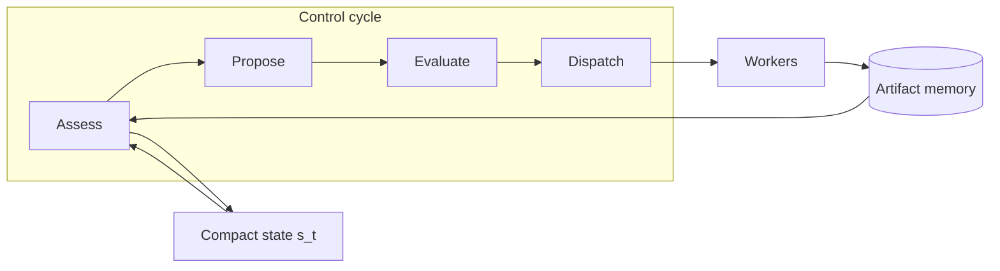

# Findings: Meta Agentic Meta-Reasoning and Compute-Aware Control

**Date:** 2026-10-11  
**Trigger:** [VentureBeat — Why giving AI agents more compute isn't enough](https://venturebeat.com/orchestration/why-giving-ai-agents-more-compute-isnt-enough-and-what-meta-proposes-instead) (Ben Dickson, 2026-10-08)  
**Primary source:** Dahal et al., *Thinking Before Thinking: Scaling Agentic Inference Through Meta-Reasoning* (Meta Superintelligence Labs, arXiv [2609.38147](https://arxiv.org/abs/2609.38147), 2026-09-29)  
**Scope:** Synthesize industry commentary, Meta’s proposal, adjacent 2025–26 research on budget-aware agents, and a concrete incorporation path for **lmloop**  
**Audience:** Harness architects, eval owners, and anyone extending long-horizon `until` / company / campaign flows  
**Companions:** [FINDINGS_OPEN_SOURCE_AGENT_HARNESSES.md](FINDINGS_OPEN_SOURCE_AGENT_HARNESSES.md) · [DESIGN_LONG_HORIZON_PLANNING.md](DESIGN_LONG_HORIZON_PLANNING.md) · [DESIGN_DAG_AND_KNOWLEDGE_CANVAS.md](DESIGN_DAG_AND_KNOWLEDGE_CANVAS.md) · [DESIGN_USAGE_EVALS_AND_SELF_IMPROVEMENT.md](DESIGN_USAGE_EVALS_AND_SELF_IMPROVEMENT.md) · [DESIGN_CONTINUAL_HARNESS_AND_SANDBOX_EVOLUTION.md](DESIGN_CONTINUAL_HARNESS_AND_SANDBOX_EVOLUTION.md)

---

## Executive summary

1. **More inference budget alone often plateaus.** Production and research agents frequently stop early or spend extra model/tool calls without composable follow-up work. VentureBeat and Meta frame this as a **metacognitive control** problem: assessing progress and choosing the next computation under a shared budget.

2. **Meta’s agentic meta-reasoning** splits **workers** (task-level computation, including full coding agents) from a **controller** that runs a four-stage cycle — **Assess → Propose → Evaluate → Dispatch** — over **compact state** plus **persistent artifact memory**. Context for new work is selected artifact-by-artifact, not by replaying full transcripts. Dependencies form an **artifact graph** used for diagnosis (reuse, coverage vs selection, budget utilization).

3. **Empirical headline (matched budgets):** At 100 calls on three reasoning benchmarks and 1200 on ProgramBench, meta-reasoning wins all 12 matched comparisons vs **Direct Control** (same workers, single-step control over accumulated history). ProgramBench + GPT-5.5: **71.5%** hidden-test pass vs **63.7%** direct control and **58.0%** Codex. Gains grow with budget where direct control flatlines (e.g. ProgramBench GPT-5.5: 64.1% @ 400 calls → 71.5% @ 1200; direct control ~64% while using ~18% of allowance at 1200).

4. **This complements — does not replace — harness evolution.** Meta-reasoning optimizes **within a run**; GEPA/flywheels (see open-source harness findings) optimize **across runs**. Enterprise teams can add a control layer without fine-tuning base models; paper includes prompt-level specs for controller stages, workers, memory tools, and ProgramBench git/read-only verification patterns.

5. **For lmloop**, the closest fit is not replacing `act()` but adding an optional **meta-controller** above existing **makers** (`until`), **graph nodes**, and **company workers**, reusing **snapshots**, **checks**, **knowledge graph / canvas**, **campaign plan store**, and **traces** for artifacts and metrics. Phased rollout below keeps laptop-first constraints (single model slot, sequential workers).

---

## 1. The problem VentureBeat and Meta describe

### 1.1 Metacognitive control

Long-horizon agents must repeatedly decide:

| Decision | Failure mode if wrong |
|----------|------------------------|
| Trust an intermediate result | Waste budget on a dead end |
| Build on partial work | Abandon a correct partial solution |
| Investigate vs rewrite vs verify vs stop | Overspend or stop too early |
| Which context to pass to the next step | Bury signal in unbounded history |

Meta calls this **metacognitive control**: monitoring one’s own computation and regulating what happens next ([Liu et al., 2026](https://arxiv.org/abs/2601.03287) cited in the paper).

### 1.2 Why “scale compute” under-delivers

Several 2025–26 lines converge on the same symptom:

| Mechanism | Source | Symptom |
|-----------|--------|---------|
| Fixed test-time structure (N samples, fixed critique rounds, static trees) | Wei/Wang/Yao-style scaling; paper §2 | Structure chosen before the task reveals useful work |
| **Direct control** — next action chosen in one step over full history | Meta baseline | Context blow-up; early stop; shallow independent retries |
| No **budget awareness** | [Budget-Aware Tool Use (BATS)](https://arxiv.org/abs/2511.17006) | Performance ceiling despite higher tool-call limits |
| Uniform per-step scaling | [CATTS](https://arxiv.org/abs/2602.12276) | Diminishing returns on long web-agent trajectories |
| Search without explicit **value-of-computation** | [Inference-Time Budget Control for LLM Search Agents](https://arxiv.org/html/2605.05701) | Suboptimal retrieval/decompose/stop under dual budgets |

VentureBeat’s coding example (pass some tests, fail edge cases — investigate, patch, re-test, or stop?) is the user-facing version of Meta’s proof/reconstruction settings.

### 1.3 Distinction: runtime control vs harness optimization

| Layer | What changes | Meta / industry examples |
|-------|----------------|---------------------------|
| **Within-run control** | How the next model call is chosen given state + budget | Agentic meta-reasoning; BATS; CATTS; VOI search controllers |
| **Across-run harness** | Prompts, graphs, tools, condensers after trajectories | Meta-Harness, Fugu, GEPA/DSPy, lmloop `/retro` + eval gates |

Meta explicitly positions meta-reasoning as isolating **control** rather than training a new orchestrator or searching task-specific harnesses (paper §2, related work on GPTSwarm, AgentOrchestra, Conductor, Trinity).

---

## 2. Meta’s proposal: agentic meta-reasoning

### 2.1 Architecture (workers + controller)



- **Workers:** Single LLM calls or tool-using coding agents. Interface: instruction `g` + artifact context set `C ⊆ M_t` → new artifact `y`.
- **Controller:** Epistemic actions — `Read(I)`, `Write(u)`, launch worker batch, `Stop(y*)` where `y*` must already exist in memory.
- **Compact state `s_t`:** Controller-authored running assessment (rewritten each cycle). Workers never see private controller deliberation from other stages—only dispatch instructions and selected artifacts.
- **Shared budget `B`:** Controller and worker calls draw from the same allowance; extra deliberation must pay for itself (paper §3.5).

### 2.2 Four stages (APED)

| Stage | Role | Coding-agent instantiation (VentureBeat / paper) |
|-------|------|---------------------------------------------------|
| **Assess** | Integrate new worker outputs into `s_t`; tag areas implemented / broken / unverified / unexplored | Read test logs, git state via read-only tools; update status map |
| **Propose** | Generate candidate next actions without budget filtering yet | e.g. fix failing tests, add missing API, independent audit of module X |
| **Evaluate** | Score proposals against **remaining budget** and expected value | Prefer targeted fix over rewrite of working code |
| **Dispatch** | Issue worker instructions + artifact IDs for context, or stop with chosen submission | Parallel workers allowed; ProgramBench serializes conflicting writes to shared workspace |

Each stage may be multi-call (investigation before commitment).

### 2.3 Artifact memory and artifact graph

- Every worker output and controller note is an **artifact** with stable ID.
- When worker `j` receives context artifacts `C_j`, edges `(i → j)` are recorded → **DAG** of dependencies.
- Diagnostics (paper §4) use the graph plus optional correctness labels on solution artifacts:

| Metric | Question |
|--------|----------|
| **Budget utilization** `U` | Did the run use its allowance productively? |
| **Graph topology** | Independent retries vs depth, fan-in, reuse |
| **Coverage** `Pr(C)` | Did any correct solution artifact appear? |
| **Selection** `Pr(S|C)` | Given a correct artifact existed, was it submitted? |
| **Monitoring (Type-2 AUC)** | Do worker/controller confidence signals rank correct above incorrect? |
| **Frontier selection gain (FSG)** | Did submission beat random choice among deepest terminal artifacts? |

These separate **search failure** (never found answer) from **recognition failure** (found but submitted wrong artifact)—invisible to final score alone.

### 2.4 Direct Control baseline (what Meta compares against)

**Direct Control Agent:** Same workers, memory APIs, and budget; **no** staged controller—each action is one model turn over accumulated history. This isolates **structured control + state compression** rather than worker quality.

### 2.5 Benchmarks and results (paper §5)

| Benchmark | Task shape | Main budget |
|-----------|------------|-------------|
| IMO ProofBench-Advanced | Proof search | 100 calls |
| ARC-AGI-2 | Abstract visual reasoning | 100 calls |
| LongCoT-mini | Multi-domain long reasoning | 100 calls |
| ProgramBench | Reconstruct codebase from docs + execute-only reference | 400 / 800 / **1200** calls |

Models: Gemini 3.1 Pro, GPT-5.5, Opus 4.8.

**Matched comparison (meta-reasoning vs direct control):** +3.6 to +4.2 points mean by benchmark; all 12 main comparisons favor meta-reasoning.

**External coding baselines (ProgramBench, illustrative):**

| System | GPT-5.5 pass rate (paper Table/Fig) |
|--------|-------------------------------------|
| Meta-Reasoning Agent | **71.5%** |
| Direct Control | 63.7% |
| Codex | 58.0% |
| Claude Code (Opus 4.8) | 65.5% vs meta-reasoning **67.2%** |

**Scaling behavior:** Meta-reasoning improves as allowance increases on ProgramBench; direct control often **plateaus** and **under-uses** budget (~18% of 1200 calls in the GPT-5.5 example). **Caveat:** At **small** budgets, controller overhead can make meta-reasoning **worse** than direct control until budget is large enough (VentureBeat; paper discussion).

**ProgramBench engineering details worth copying:**

- Workers commit to git; controller verifies claims via read-only repo inspection.
- Running assessment tracks verification status per capability.
- Restrict parallel mutating workers on one workspace to avoid clobbering.

No official open-source harness ship date in the paper; specifications for prompts and tools are in appendices for replication.

---

## 3. Related Meta and industry work (same theme: allocate compute deliberately)

| Work | Focus | Relation to meta-reasoning |
|------|--------|----------------------------|
| [AIRA₂](https://ai.meta.com/research/publications/aira-overcoming-bottlenecks-in-ai-research-agents/) (2026) | Async multi-GPU experiment pool, hidden consistent evaluation, ReAct research agents | **Throughput + evaluation** for ML research agents—not the same controller, but same “don’t waste GPU on bad branches” ethos |
| [AI Research Preference Models (RPM)](https://arxiv.org/html/2608.13940) | Pairwise tournament to pick which experiment candidate gets GPU | **Budget allocation before execution**; complements meta-reasoning’s within-run dispatch |
| [Agentic Meta-Orchestrator (AMO)](https://arxiv.org/html/2510.22781) (Microsoft) | Meta-learned decision tree over agent/model combos for copilots | Production **routing** meta-layer; less explicit artifact graph |
| BATS / Budget Tracker | Web search agents | Lightweight **budget visibility** + adaptive planning—good **phase 0** before full APED |
| CATTS | Web agents | Uncertainty-triggered extra compute—overlaps with **Evaluate** stage heuristics |
| VOI search controller | Multi-hop QA | Formal **value per budget unit** at search nodes—could inform **Evaluate** scoring rubric |

**Synthesis:** Meta’s 2026 agent stack treats **orchestration as a first-class inference problem**: what to run next, with what context, under what budget—whether the “workers” are proof steps, file edits, or GPU experiments.

---

## 4. Mapping to lmloop’s harness taxonomy

Cross-reference [FINDINGS_OPEN_SOURCE_AGENT_HARNESSES.md §2](FINDINGS_OPEN_SOURCE_AGENT_HARNESSES.md) layers:

| Layer | Today in lmloop | Meta-reasoning analogue |
|-------|-----------------|-------------------------|
| L4 Skills | `/plan`, `/investigate`, `/qa`, `ceo` | Controller **stage prompts** (Assess/Propose/Evaluate/Dispatch) as skills or private `_meta_*` playbooks |
| L6 Control logic | `until` + external checks; authored `graph`; company orchestrator | **Meta-controller loop** scheduling makers/workers |
| L5 Memory | learnings, decisions, campaign `plan.jsonl` | **Artifact store** + compact **run state** (distinct from pitfall learnings) |
| L7 Evolution | usage gaps, golden evals, abstention pairs | **Artifact-graph metrics** (coverage/selection/utilization) as new eval dimensions |
| Verification | `checks.py`, snapshots, `--docker` | Worker/checker separation already mirrors “workers don’t grade themselves”; meta-controller **must not** replace `checks` for pass/fail |

**Important invariant (keep):** `loop.py` principle — the maker does not declare the goal done; external check/eval decides. Meta’s controller **Stop** chooses among **existing** artifacts; lmloop should still require **check/eval pass** (or human gate) before treating a run as complete unless explicitly in research mode.

---

## 5. Incorporation proposal for lmloop

**Design doc status:** Actionable spec in [DESIGN_META_CONTROL_AND_BUDGET.md](DESIGN_META_CONTROL_AND_BUDGET.md) (modes `off` | `budget` | `meta`, tasks M0–M5).

### 5.1 Principles

1. **Opt-in** (`--meta` or `until --control meta`) so default REPL/`until` latency and cost stay unchanged.
2. **Reuse workers** — meta-controller calls existing `act()` / company worker spawn with scoped handoffs, not a second agent runtime.
3. **Single-writer artifacts** — host orchestrator (or `until` host) appends artifact index; workers return envelopes only.
4. **Budget in one currency** — extend `run_token_budget` / model-call counters to include controller stages (align with `server.py` accounting).
5. **Graph is derived** — record `(context_artifact_ids → child_artifact_id)` in run JSONL; project to `knowledge_graph.py` / canvas optionally.

### 5.2 Phased rollout

| Phase | Deliverable | Effort / risk | Dependencies |
|-------|-------------|---------------|--------------|
| **M0 — Budget visibility** | Inject remaining call/token budget into maker + orchestrator prompts; log utilization in traces | Low | `chat.py`, `usage.py`, BATS-inspired |
| **M1 — Artifact index** | Stable artifact IDs for handoffs, check outputs, worker summaries; `Read(ids)` via host | Medium | `loop.py` events, `memory.py` or run-scoped store |
| **M2 — Compact assess state** | Replace monotonic handoff growth with rewritten **status block** each cycle (keep full artifacts on disk) | Medium | `compact` skill patterns |
| **M3 — APED controller** | Four-stage controller skill chain; dispatch spawns one maker cycle per worker batch | High | M1–M2, eval model for cheap controller |
| **M4 — Graph diagnostics** | Offline metrics: utilization, depth, coverage/selection when labels exist (tests, golden cases) | Medium | `traces.py`, `evals.py`, `workflow.py` |
| **M5 — Company / campaign** | Campaign tick runs Assess+Propose on board; dispatch to Docker workers with artifact context | High | [DESIGN_LONG_HORIZON_PLANNING.md](DESIGN_LONG_HORIZON_PLANNING.md), company orchestrator |

**Defer:** Parallel meta-workers on one repo without worktrees (Meta ProgramBench serializes writes; lmloop already uses worktrees for company parallel cap 2).

### 5.3 Suggested on-disk shape (run-scoped)

```
~/.lmloop/projects/<slug>/runs/<run_id>/
├── events.jsonl          # existing
├── meta/
│   ├── state.md            # current s_t (compact assessment)
│   ├── artifacts.jsonl     # id, kind, summary, path/ref, parent_ids[]
│   └── graph.json          # optional materialized edges
```

Controller stages append to `artifacts.jsonl` and rewrite `state.md`. Dispatch references artifact IDs in maker handoff JSON (extends existing `handoff` in `loop.py`).

### 5.4 Controller prompts (conceptual)

Mirror paper appendices without copying verbatim:

- **Assess:** Merge new evidence; classify subgoals {done, failing, unverified, unknown}; cite artifact IDs.
- **Propose:** List ≥3 diverse actions (investigate, patch, test, rollback, escalate human); no budget yet.
- **Evaluate:** Score each action on expected information gain, regression risk, estimated call cost; drop actions exceeding budget.
- **Dispatch:** Emit structured `{ workers: [{ instruction, context_artifact_ids }] }` or `{ stop_artifact_id }`.

Use **`eval_model`** for controller when configured to preserve maker model for code changes.

### 5.5 Evaluation hooks (extend assertion pyramid)

Add optional **trajectory rubrics** ([DESIGN_ASSERTION_DRIVEN_EVALS.md](DESIGN_ASSERTION_DRIVEN_EVALS.md)):

| Rubric | When |
|--------|------|
| `budget_utilization >= 0.5` on long `until` fixtures | Detect direct-control-style early quit |
| `artifact_reuse_edges >= N` | Encourage compositional work |
| `check_pass` | Still mandatory for success |
| Golden **coverage** cases | Store intermediate good patches in fixture metadata for selection metrics |

Pair with abstention evals where meta-controller should **stop and ask** rather than burn budget ([DESIGN_USAGE_EVALS_AND_SELF_IMPROVEMENT.md](DESIGN_USAGE_EVALS_AND_SELF_IMPROVEMENT.md)).

### 5.6 When **not** to enable meta-reasoning

- Short tasks with &lt; ~10 model calls (overhead dominates).
- Single-shot Q&A REPL turns.
- Strict latency SLOs where four controller stages are unaffordable.
- Tasks without verifiable intermediate artifacts (hard to Assess).

---

## 6. Open questions

1. **Call vs token budget:** Meta counts model calls; lmloop often limits tokens — need a normalized **cost unit** for Evaluate stage.
2. **Controller trust:** Assess must not trust worker self-report without check/git evidence (ProgramBench pattern).
3. **Human-in-the-loop:** Dispatch `escalate` as first-class action vs implicit pause role in `until`.
4. **Selection failures:** When check passes on branch A but controller stops on branch B, auto-run check on stop candidate or force controller to stop only on check-passing artifact IDs.
5. **Relation to authored graphs:** Static `graph.md` vs dynamic APED — hybrid: graph for milestones, meta-controller for within-node exploration.

---

## 7. References

| ID | Citation |
|----|----------|
| VB26 | Dickson, B. (2026). *Why giving AI agents more compute isn't enough—and what Meta proposes instead.* VentureBeat. https://venturebeat.com/orchestration/why-giving-ai-agents-more-compute-isnt-enough-and-what-meta-proposes-instead |
| M26 | Dahal, P., et al. (2026). *Thinking Before Thinking: Scaling Agentic Inference Through Meta-Reasoning.* Meta Superintelligence Labs. arXiv:2609.38147. https://arxiv.org/abs/2609.38147 |
| AIRA2 | Hambardzumyan, K., et al. (2026). *AIRA₂: Overcoming Bottlenecks in AI Research Agents.* Meta AI. https://ai.meta.com/research/publications/aira-overcoming-bottlenecks-in-ai-research-agents/ |
| RPM | *AI Research Preference Models.* arXiv:2608.13940. https://arxiv.org/html/2608.13940 |
| BATS | Liu, T., et al. (2025). *Budget-Aware Tool Use Enables Effective Agent Scaling.* arXiv:2511.17006. |
| CATTS | Lee, N., et al. (2026). *Agentic Test-Time Scaling for WebAgents.* arXiv:2602.12276. |
| VOI | *Inference-Time Budget Control for LLM Search Agents.* arXiv:2605.05701. |
| AMO | *Agentic Meta-Orchestrator for Multi-task Copilots.* arXiv:2510.22781. |

---

## 8. Decision log (for future implementers)

| Date | Decision |
|------|----------|
| 2026-10-11 | Document research synthesis; recommend M0→M5 phased adoption; do not change default `until` behavior until M3 validated on golden evals. |
