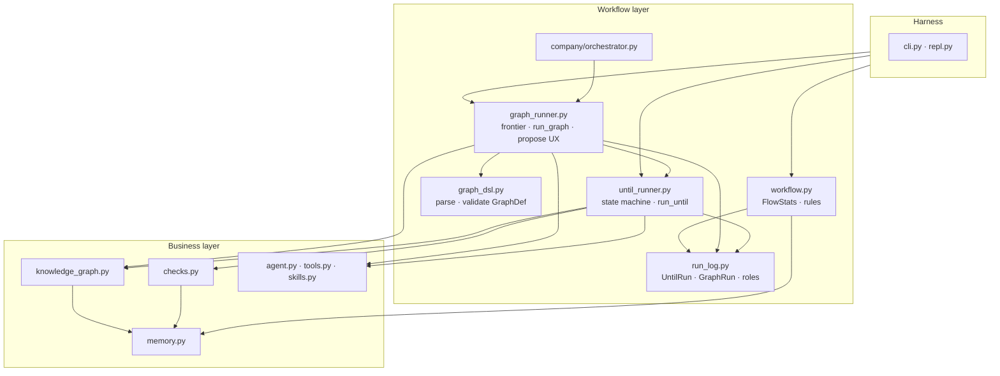

# Design: Business layer vs workflow layer

**Status:** shipped — BL-1–BL-6 (run log, DSL, finish hook, runners, facades)  
**Date:** 2026-10-11  
**Depends on:** `run_log.py`, `until_runner.py`, `graph_dsl.py`, `graph_runner.py`, `workflow_finish.py`, `checks.py`, `knowledge_graph.py`, [DEVELOPMENT.md](../../DEVELOPMENT.md) import graph  
**Companions:** [ARCHITECTURE.md](../ARCHITECTURE.md) · [DESIGN_DAG_AND_KNOWLEDGE_CANVAS.md](../DESIGN_DAG_AND_KNOWLEDGE_CANVAS.md) · [DESIGN_GRAPH_ENGINEERING.md](DESIGN_GRAPH_ENGINEERING.md)

---

## Problem

lmloop’s **business** capabilities (what the project is, what tools exist, what counts as
proof) and **workflow** capabilities (how many isolated acts run, in what order, with what
resume semantics) grew in the same modules. That worked while `until` was one file, but today:

- `loop.py` (~1k lines) mixes JSONL run logs, the until state machine, maker/eval prompts,
  check-plan UX, gate boundaries, and terminal side effects (`record_workflow_run`, usage
  outcomes).
- `graph.py` (~1.1k lines) duplicates run-log patterns, frontier replay, pause/resume, and
  node drivers while importing a wide surface from `loop.py`.
- `workflow.py` is correctly a leaf for analytics, but `graph.propose_graph_draft` and
  `evals.format_report` still reach through workflow into orchestration-owned logs.
- `checks.py` is business logic (deterministic gates from repo artifacts) but its only
  production callers are workflow modules — that boundary is right; the leak is the other
  direction (workflow rules embedded in business types).

The product goal: **keep one user-facing behavior** (`/until`, `/graph`, `/flow`, company
mode) while making it obvious where a change belongs and stopping workflow imports from
 spreading into `agent`, `tools`, and `memory`.

---

## Definitions

| Layer | Question it answers | May call model? | Typical artifacts |
|-------|---------------------|-----------------|-------------------|
| **Harness** | How does the user invoke the agent? | Only via `agent.act` | `cli.py`, `repl.py`, `prompt.py`, `commands.py`, `status.py` |
| **Agent core** | One turn: gather/answer + tools | Yes | `agent.py`, `chat.py`, `stream.py`, `display.py`, `tools.py`, `skills.py`, `steer.py` |
| **Business** | What is true about the workspace and what proves a goal? | Only where already allowed (e.g. check proposal) | `memory.py`, `checks.py`, `knowledge_graph.py`, `snapshot.py`, `spirit/`, manifest/allowlist |
| **Workflow** | Which isolated acts run next, and what got recorded? | Orchestrates `isolated_act` / `run_until` | `loop.py`, `graph.py`, `workflow.py`, `company/orchestrator.py`, campaign *ticks* |
| **Leaf analytics** | What do past runs suggest? | No | `workflow.py`, parts of `evals.py`, `usage.py` |

**Business** code must not depend on whether the caller is REPL, CLI, a graph node, or a
company worker. **Workflow** code may depend on business types (`CheckPlan`, `PlannedCheck`,
`GatePolicy`) but not on REPL session shape.

**Not in scope for this split:** moving `agent.act` into a framework, adding a DI container,
or introducing a second tool registry.

---

## Current usage map (research)

### Importers of workflow modules

| Caller | Imports | Role |
|--------|---------|------|
| `repl.py` | `graph`, lazy `workflow` | Slash handlers `/graph`, `/until`, `/flow`, `/continue` |
| `cli.py` | `graph`, lazy `workflow` | `lmloop until`, `lmloop graph`, `lmloop flow` |
| `graph.py` | `loop` (large: `run_until`, `isolated_act`, gates, eval helpers) | Graph nodes of kind `until` delegate to loop |
| `company/orchestrator.py` | `graph`, `loop` (via workers) | Milestone frontier, not imported by loop/graph |
| `contracts.py` | lazy `graph.parse_graph` | Layer-1 graph DSL gate |
| `checks.py` | *(none of loop/graph)* | Documented leaf; loop runs plans |
| `evals.py` | lazy `workflow.FlowStats` | Usage report appendix |
| `knowledge_graph.py` | *(none of loop/graph)* | `record_workflow_run` **called from** loop/graph |

### Shared concepts duplicated across `loop` and `graph`

| Concept | `loop.py` | `graph.py` |
|---------|-----------|------------|
| Append-only JSONL run | `UntilRun` | `GraphRun` |
| Pause row | `PAUSE_ROLE`, `_pause_interrupted` | same pattern |
| Gate / approve / done roles | `next_role`, `DONE_ROLES` | `next_step`, frontier replay |
| Terminal KG write | end of `run_until` | end of `run_graph` |
| Boundary gates | `boundary_approval`, `drop_denied` | reused from loop |

### Business modules workflow already respects

- `checks.infer_plan` / `judge_cycle` / `apply_baseline` — no imports of `loop` or `graph`.
- `agent.act` / `stream` / `display` / `chat` — no imports of `loop` or `graph` (enforced in
  tests: `test_wave2.py` import scan for `canvas_tui`).
- `snapshot.py` — leaf; loop/graph pass `snapshot_ref` into rows only.

### Leakage points (fix targets)

1. **Run log + state machine in one type** — `UntilRun.next_role` and `GraphRun.frontier_state`
   belong to workflow; row schema belongs to a shared run-log module.
2. **Orchestration prompts in `loop.py`** — `MAKER_PROMPT`, `EVAL_PROMPT`, plan UX
   (`_prepare_plan`, `_model_propose_checks`) are workflow policy, not business rules.
3. **Graph DSL + runner in one file** — `parse_graph` / validation is business grammar;
   `run_graph` / frontier is workflow (matches how `contracts.py` already treats DSL).
4. **Terminal side effects** — `record_workflow_run` and `_until_outcome_label` should run
   from one workflow “finish hook”, not inline in two runners.
5. **Public re-exports** — `graph.py` imports many loop symbols; callers (`tests`, future
   company code) treat `loop` as a grab bag. Target: narrow **workflow API** surface.

---

## Target architecture

### Module split (physical)

| New / renamed module | Owns | Does not own |
|----------------------|------|--------------|
| `run_log.py` | JSONL paths, append/load, shared role constants, `UntilRun` / `GraphRun` persistence and queries (`last_handoff`, `session_paths`) | State transitions (`next_role`, frontier) |
| `until_runner.py` (name TBD; may stay `loop.py` until split) | `run_until`, `isolated_act`, maker/eval cycle, plan confirmation UX, gate wrapping | Graph topology |
| `graph_dsl.py` | `GraphDef`, `NodeDef`, `parse_graph`, validation, `load_graph`, packaged paths | Running nodes |
| `graph_runner.py` (initially second half of today’s `graph.py`) | `run_graph`, frontier, join handoffs, `propose_graph_draft` orchestration | DSL grammar |
| `workflow_finish.py` (optional thin module) | `record_workflow_run` invocation, usage outcome labels, shared “terminal row” policy | KG node semantics (stay in `knowledge_graph`) |

**Compatibility:** Keep `loop.py` and `graph.py` as facades that re-export moved symbols for
one release if needed; prefer updating call sites in the same diff per [DEVELOPMENT.md](../DEVELOPMENT.md).

### Import rules (extensions)

Existing rules stay ([DEVELOPMENT.md](../DEVELOPMENT.md)): `loop` ↛ `graph`, agent stack ↛
`loop`/`graph`, `checks` ↛ `loop`/`graph`.

Add:

| Module | May import | Must not import |
|--------|------------|-----------------|
| `run_log.py` | `memory`, `config` | `agent`, `checks`, `graph_*`, `company` |
| `graph_dsl.py` | stdlib, `config` paths | `agent`, `loop`, `checks`, `knowledge_graph` |
| `until_runner` | `run_log`, `checks`, `agent`, `snapshot`, `tools`, `workflow_finish` | `graph_runner`, `graph_dsl` |
| `graph_runner` | `run_log`, `graph_dsl`, `until_runner`, `skills`, `workflow`, `workflow_finish` | `repl`, `cli` |
| `workflow.py` | `memory`, `config`, `commands` | `agent`, `loop`, `graph`, `checks` |
| `knowledge_graph.py` | `memory` | `loop`, `graph`, `run_log` |
| Business (`checks`, `memory`, `tools`) | Other business + leaves | `loop`, `graph`, `run_log`, orchestrators |

`record_workflow_run` remains in `knowledge_graph.py` (business write API). Workflow calls it
once at terminal status via `workflow_finish`.

---

## Public workflow API (narrow surface)

After refactor, only these entry points should be imported from outside the workflow package
(by harness, company, tests):

| Entry | Purpose |
|-------|---------|
| `parse_until_args` / `UntilArgs` | CLI/REPL flag parsing |
| `run_until` | `/until`, graph `until` nodes |
| `latest_open_until_run`, `UntilRun.load` | `/continue` |
| `load_graph`, `run_graph`, `list_graphs` | `/graph`, CLI |
| `latest_open_graph_run`, `GraphRun.load` | `/continue` |
| `propose_graph_draft`, `save_proposed_graph` | `/graph propose` |
| `collect_flow_stats`, `render_flow` | `/flow`, `lmloop flow` |

Everything else (`next_role`, `_prepare_plan`, frontier helpers) becomes module-private.

---

## Migration phases

| Phase | Scope | Tests | Risk |
|-------|--------|-------|------|
| **BL-0** | This document; no code moves | — | — |
| **BL-1** | Extract `run_log.py`; move dataclasses + I/O; leave transition methods on thin subclasses or free functions in until/graph | Existing `test_workflow`, until/graph tests green | Low — mechanical |
| **BL-2** | Extract `graph_dsl.py`; `contracts.py` imports DSL module only | `test_graph`, eval gates | Low |
| **BL-3** | Add `workflow_finish.py`; dedupe KG + usage outcome from `run_until` / `run_graph` | Wave2 until/graph terminal tests | Medium — behavior must stay identical |
| **BL-4** | Move maker/eval/plan prompts + `_prepare_plan` block into `until_runner`; shrink `loop.py` to facade | Plan UX tests in sandbox doc matrix | Medium |
| **BL-5** | Split `graph_runner`; optional `workflow/` package directory if file count warrants | Full unittest + e2e harness | Medium |
| **BL-6** | Update DEVELOPMENT module table + ARCHITECTURE diagram; delete facades if no external imports remain | Import-ban tests extended to new modules | Low |

**Order:** BL-1 → BL-2 → BL-3 before any prompt moves. Do not combine BL-4 with company
orchestrator changes.

---

## Non-goals

- Replacing JSONL run logs with SQLite or an event bus.
- A generic workflow engine (timers, cron, expressions beyond authored edges).
- Moving `checks.py` inference into the model or into `tools.py`.
- Merging knowledge graph and workflow graph (see [DESIGN_COMMAND_CONSOLIDATION.md](DESIGN_COMMAND_CONSOLIDATION.md)).
- Parallel local agents ([DESIGN_DAG_AND_KNOWLEDGE_CANVAS.md](DESIGN_DAG_AND_KNOWLEDGE_CANVAS.md) Part 5).

---

## Success metrics

- `loop.py` + `graph_runner` combined line count drops meaningfully; neither file owns DSL
  parsing and running.
- Import-ban tests cover `run_log` and `graph_dsl` (no `agent` / `loop` cycles).
- A new contributor can answer “does this belong in business or workflow?” using the table in
  §Definitions without reading 2k lines of Python.
- No user-facing change to `/until`, `/graph`, `/flow`, or company graphs; golden eval gates
  unchanged.

---

## Open questions

1. **Package vs flat files:** Stay flat under `lmloop/` until BL-5; use `lmloop/workflow/`
   only if `run_log`, `until_runner`, and `graph_runner` together exceed ~1.5k lines.
2. **`campaign.py`:** Daily tick is workflow-shaped but must not import `loop`/`graph`
   today — classify as workflow orchestration when touching campaigns, not business.
3. **Evals + flow printer:** [DESIGN_USAGE_EVALS_AND_SELF_IMPROVEMENT.md](DESIGN_USAGE_EVALS_AND_SELF_IMPROVEMENT.md) wants one printer over usage + run logs; implement that in
   `evals.py` (leaf) after BL-1 stabilizes row readers in `run_log` / `workflow.py`.
